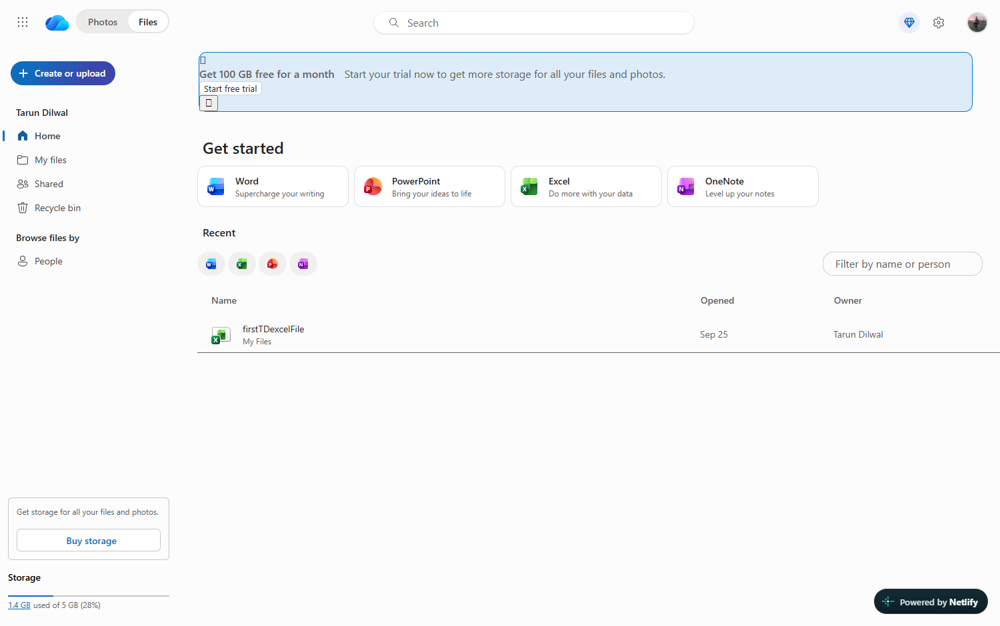
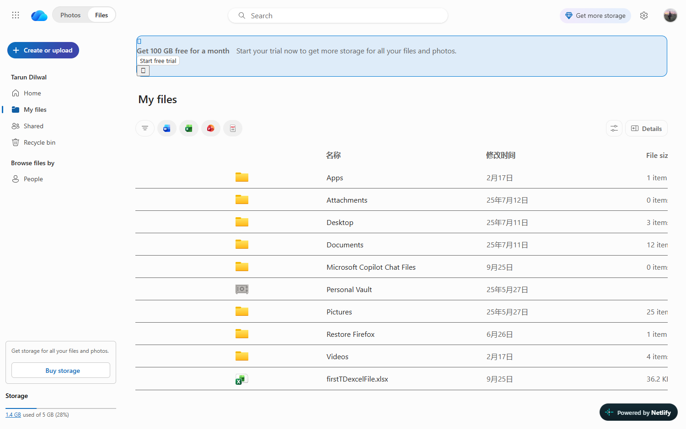
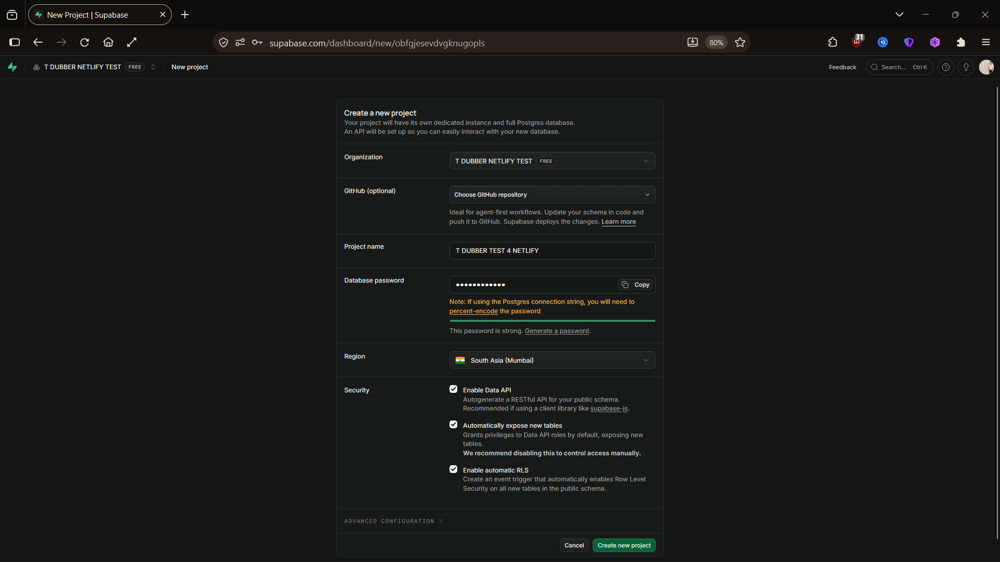
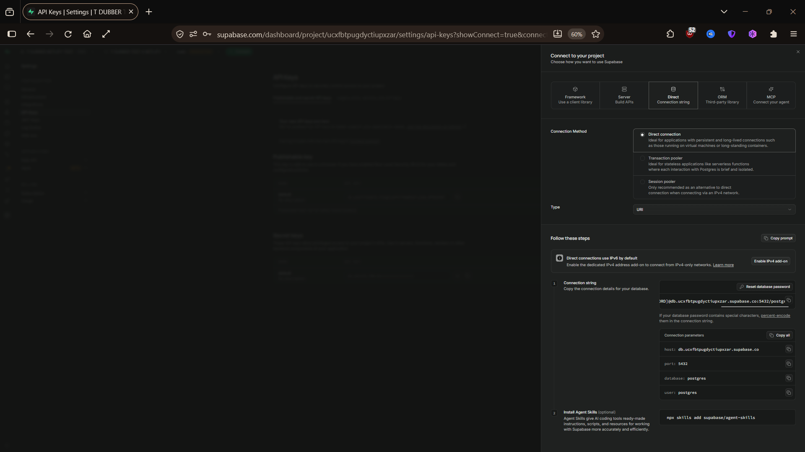
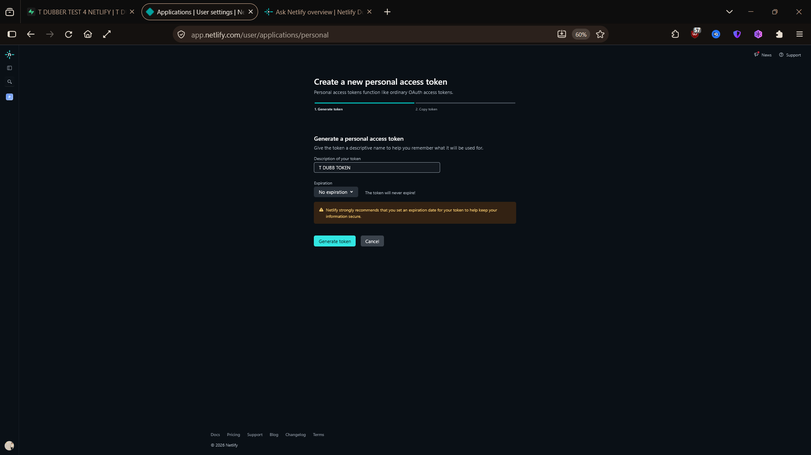
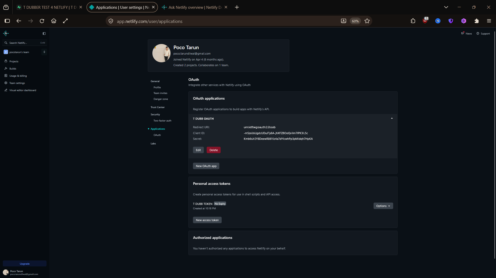

<div align="center">

# 📁 drive

**Apna drive — Next.js + Tailwind + TypeScript + Supabase**

[](https://t-dubber-drive-test.netlify.app/drive-ui/index.html)

**👉 [Live demo — khol ke dekhne ke liye click karo](https://t-dubber-drive-test.netlify.app/drive-ui/index.html)**

<sub>Captured drive UI, byte-for-byte unchanged · Supabase Postgres · Netlify + Cloudflare ready</sub>

</div>

---

## Kya hai ye

Ek **drive app** — Next.js 15 + Tailwind + TypeScript. UI ek captured OneDrive
drive hai jo Firecrawl se aayi thi; wo **bilkul unchanged** hai, byte-identical.
App usi ko apne localhost/deploy pe serve karta hai, aur peeche Supabase
(Postgres) se connected hai.

| | |
|---|---|
| **Live demo** | https://t-dubber-drive-test.netlify.app/drive-ui/index.html |
| **Stack** | Next.js 15.5.27 · React 19.1 · Tailwind 3.4 · TypeScript 5 |
| **Database** | Supabase (PostgreSQL 17) |
| **Deploy** | Netlify (live) · Cloudflare Pages (ready) · Docker |

---

## 📸 Screenshots

### 🟢 Live — Netlify pe deployed

**Home**


**My Files**


### Captured UI — byte-for-byte unchanged

Source: [`public/drive-ui/index.html`](public/drive-ui/index.html)
(`310,280 bytes`) aur [`public/drive-ui/pages/my.html`](public/drive-ui/pages/my.html)
(`472,683 bytes`).

Ye dono pages app se serve hoti hain apne relative asset links ke saath
(`./assets/…` index se, `../assets/…` pages se) — koi link badla nahi gaya,
koi asset copy nahi hua.

### 🔌 Live DB proof

`GET /api/db-check` — netlify.app pe, live:

```json
{ "ok": true, "configured": true, "backend": "postgres",
  "counts": { "users": {"rows": 0}, "folders": {"rows": 0}, "files": {"rows": 0} },
  "latency_ms": 1989 }
```

Ye Netlify ke server se Supabase tak actually jaata hai — `ok:true` matlab
connection ban gaya, teeno tables par query chal gayi.

### Setup — kaise banaya

<details>
<summary><b>Supabase project (click to expand)</b></summary>



Project `T DUBBER TEST 4 NETLIFY` · Region **South Asia (Mumbai)** · Free (NANO)



Connection parameters: host `db.<ref>.supabase.co` · port `5432` · db `postgres`

</details>

<details>
<summary><b>Netlify (click to expand)</b></summary>





</details>

> 🚨 Do screenshots me live secrets the — wo **deliberately git se exclude** hain
> (`drive/.gitignore`), kyunki ek commit permanent hota hai. Details:
> [`docs/setup-screenshots/README.md`](docs/setup-screenshots/README.md)

---

## 🚀 Chalane ka tareeqa

### Local

```bash
cd drive
npm install
npm run dev
```

→ http://localhost:3000 (root redirect ho jayega drive pe)

### Docker

```bash
cd drive
docker build -t drive .
docker run -p 3000:3000 \
  -e DATABASE_URL="postgresql://…" \
  drive
```

Multi-stage build: final image me build toolchain, npm cache aur
devDependencies nahi jaate — sirf `node server.js`.
([`next.config.ts`](next.config.ts) me `output: "standalone"` isliye hai.)

---

## 🗄️ Database

**Supabase (Postgres)** — `users` · `folders` · `files`

### Kyun Postgres, SQLite kyun nahi

Is repo ka doosra DB `t_dubber.db` hai (`main` branch, `db.py`) — wo **SQLite**
hai aur wahi sahi hai: single-writer local telemetry store. **Use migrate mat
karo.**

Ye app alag hai: ye Netlify Functions aur Cloudflare Pages pe chalta hai, jahan
filesystem **ephemeral** hai — har cold start aur har deploy pe local disk wipe.
SQLite file wahan chup-chaap khatam ho jayegi. Sirf network bacha rehta hai.

### Do raaste, dono jaan-boojh kar

| Backend | Transport | Netlify | Cloudflare | Chahiye |
|---|---|---|---|---|
| `@supabase/supabase-js` | HTTPS (REST) | ✅ | ✅ | URL + `service_role` key |
| `pg` | raw TCP | ✅ | ❌ free tier | `DATABASE_URL` |

Order fix hai: **HTTPS pehle**, TCP baad me. Cloudflare Workers free tier me
outbound TCP allow nahi karta, isliye portable path hamesha jeetta hai — ek
deploy chup-chaap us socket pe depend nahi ho sakti jo usse khulega hi nahi.

> **Correction, record me rakhne layak:** pehle `@neondatabase/serverless` laga
> tha, "edge-native hai" soch se. Supabase ke liye wo **galat** hai — driver ka
> apna source dekha: wo `https://<host>/sql` pe `Neon-Connection-String` header
> bhejta hai, jo Neon ka proprietary gateway hai. Supabase ise implement nahi
> karta; wo sirf Neon se baat karta hai.

### Setup

```bash
npm run db:schema   # schema apply (SQL Editor ki zaroorat nahi)
npm run db:check    # teen "ok" lines = sab set
```

`db:schema` seedha Postgres pe TCP se chalta hai — browser, SQL Editor ya kisi
UI ki zaroorat nahi. Supabase ka *direct* host IPv6-only hota hai, isliye
script **pooler** host (`aws-0-<region>.pooler.supabase.com`) use karta hai jo
IPv4 pe bhi jawab deta hai.

### Proof

```
GET /api/db-check
```

Ye **deployed platform se khud** database tak jaata hai aur row counts wapas
deta hai — `backend` field batata hai kaun sa raasta use hua. Missing
credentials pe `503` + saaf message; schema missing pe `502` + "run db:schema".

Serverless ka classic jhooth — "local pe chalta hai, deploy pe chup-chaap sab
bhool jaata hai" — isi route se pakda jaata hai.

---

## 📁 Structure

| Path | Kya hai |
|---|---|
| `public/drive-ui/` | Captured UI — **verbatim, kabhi mat chhedо** |
| `app/page.tsx` | Sirf redirect `/` → `/drive-ui/index.html` |
| `app/api/db-check/` | Live DB proof |
| `lib/db.ts` | Dono backends, HTTPS pehle |
| `db/schema.sql` | `users` · `folders` · `files` |
| `db/apply-schema.mjs` | `npm run db:schema` |
| `netlify.toml` | Next.js Functions wiring |
| `Dockerfile` | Multi-stage, standalone output |

---

## ⚠️ Security notes

- `.env.local` gitignored hai — credentials kabhi repo me mat daalo.
- `SUPABASE_SERVICE_ROLE_KEY` RLS bypass karta hai: **sirf server pe**. Kabhi
  `NEXT_PUBLIC_` mat banao, warna browser tak pahunch jayegi.
- Setup screenshots me do live secrets hue the. Wo `.gitignore` me hain.
  **Credentials rotate karna abhi bhi bacha hai.**

### CVE-2025-66478 — note

Ye project pehle `next@15.4.3` par tha, jo
[CVE-2025-66478](https://nextjs.org/blog/CVE-2025-66478) se affected hai — aur
**Netlify ne deploy hi block kar diya** (HTTP 400):

> *"You're currently using a version of Next.js affected by a critical security
> vulnerability. To protect your project, we're blocking further deploys until
> you update your Next.js version."*

Ab `next@15.5.27` (patched 15.x) pe hai. React `19.1.0` hi rakha — vulnerable
part Next ka bundled React Server Components runtime hai, React package nahi.

> Lesson: `npm install` deprecation warning ignore mat karo. Yahi warning thi
> jo deploy ko rok rahi thi.

---

<div align="center">
<sub>Made in T_Dubber · <a href="../AGENTS_MAP.md">AGENTS_MAP</a></sub>
</div>